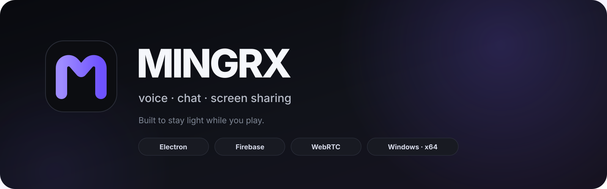
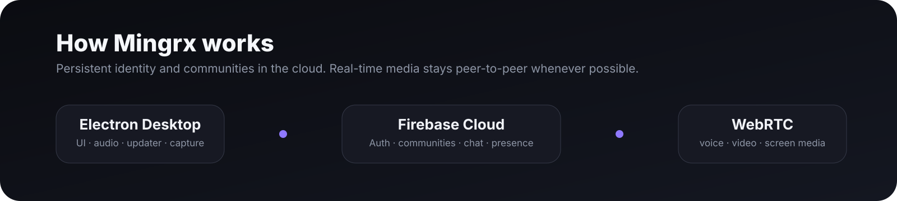

<p align="center">
  
</p>

<p align="center">
  <a href="https://github.com/rafaelmingroni/mingrx-app/releases/latest"></a>
  
  
  
  
  
</p>

# Mingrx

**Mingrx é um aplicativo desktop de comunicação para amigos e pequenos grupos, criado para ser bonito, direto e leve enquanto você joga.**

Ele reúne comunidades, chat, canais de voz, mensagens privadas, webcam e compartilhamento de tela em um aplicativo para Windows com foco em **baixo impacto durante jogos**.

> **Mingrx 3.0 está em validação antes do lançamento público.**  
> O projeto nasceu como **Banana Cord** e está migrando para a nova identidade sem abandonar a compatibilidade das instalações existentes.

## O que é o Mingrx

O objetivo é manter o essencial de um app de comunidade e call sem transformar o desktop em mais uma camada pesada sobre o jogo.

- comunidades persistentes;
- canais de texto e voz;
- mensagens privadas;
- amigos, presença e perfis;
- webcam;
- compartilhamento de tela;
- convites por link;
- atualização automática;
- interface pensada para ser rápida, limpa e discreta.

## Mingrx 3.0

A V3 é a maior evolução do projeto até agora.

### Nova identidade

- marca **Mingrx** em toda a experiência visível;
- novo logo e novo ícone;
- direção visual em grafite e violeta;
- temas de aparência;
- navegação de comunidades mais compacta;
- painel de membros contextual;
- menos ruído visual e mais foco no conteúdo.

### Chat e mídia

- anexos de imagem em canais;
- imagens em mensagens privadas;
- colar screenshots diretamente do clipboard;
- compactação automática antes do upload;
- visualização ampliada de imagens;
- foto personalizada para comunidades;
- Firebase Storage protegido por regras próprias.

### Voz, vídeo e tela

- voz por WebRTC;
- mute, deafen e push-to-talk;
- indicador de fala;
- volume individual;
- seleção e teste de microfone;
- webcam;
- compartilhamento de tela em 720p/1080p e 30/60 FPS;
- monitoramento de RTT durante chamadas.

## Arquitetura

<p align="center">
  
</p>

| Camada | Responsabilidade |
| --- | --- |
| **Electron** | aplicativo desktop, interface, áudio, captura e integração com Windows |
| **Firebase Authentication** | contas e verificação de identidade |
| **Cloud Firestore** | comunidades, membros, canais, mensagens e DMs |
| **Realtime Database** | presença e sinalização em tempo real |
| **Firebase Storage** | fotos de comunidades e anexos de imagem |
| **WebRTC** | voz, webcam e compartilhamento de tela |
| **GitHub Actions** | testes, validações, build e pipeline de release |
| **electron-updater** | atualização automática do aplicativo |

## Migração do Banana Cord

A mudança de marca foi planejada para preservar o caminho de atualização de quem já possui Banana Cord instalado.

O identificador interno de produção no Windows continua sendo:

```text
com.bananacord.app
```

Isso é proposital. O nome visível passa a ser **Mingrx**, mas manter essa identidade técnica reduz o risco de o Windows tratar a V3 como um segundo aplicativo separado.

O protocolo antigo `bananacord://` também continua aceito por compatibilidade, enquanto novos convites usam `mingrx://`.

## Instalação

A release pública mais recente continua disponível em:

**[GitHub Releases](https://github.com/rafaelmingroni/mingrx-app/releases/latest)**

Quando a V3 concluir a validação, o instalador oficial seguirá o padrão:

```text
Mingrx-Setup-3.0.0-x64.exe
```

O instalador ainda não possui assinatura digital de código, então o Windows SmartScreen pode exibir um aviso.

## Atualizações automáticas

O Mingrx usa **GitHub Releases + electron-updater**.

Cada release oficial publica:

```text
Mingrx-Setup-x.x.x-x64.exe
Mingrx-Setup-x.x.x-x64.exe.blockmap
latest.yml
```

A V3 está sendo preparada para continuar o fluxo de atualização das instalações existentes em vez de exigir uma reinstalação separada.

## Segurança e privacidade

O projeto usa autenticação Firebase com e-mail verificado e regras específicas para acesso aos dados e uploads.

A mídia das chamadas usa WebRTC. Firestore e Realtime Database cuidam dos dados persistentes e da sinalização; áudio, vídeo e tela permanecem separados dessa camada sempre que possível.

Antes de uma release pública, o pipeline valida:

- JavaScript;
- regressões Cloud e UI;
- identidade visual Mingrx;
- mídia e convites;
- regras do Firestore, Realtime Database e Storage;
- interações reais via Electron;
- instalador e metadados de auto-update.

## Estrutura do repositório

```text
desktop/                aplicativo Electron
├─ assets/              identidade e ícones
├─ scripts/             testes, E2E e helpers de build
├─ server/              camada local/legada
└─ src/                 renderer, UI, Cloud e camadas Mingrx

firebase/               regras e configuração Firebase
docs/                   documentação e página de convites
.github/workflows/       CI, validações e releases
```

## Roadmap

A evolução continua focada em quatro frentes:

1. **experiência** — consistência visual e menos atrito;
2. **leveza** — reduzir trabalho desnecessário durante jogos e calls;
3. **confiabilidade** — fortalecer testes de voz, tela, chat e updater;
4. **produto** — melhorar entrada, convite, comunidades e atualização.

## Status da V3

O desenvolvimento ativo da V3 acontece na branch:

[`v3.0.0-mingrx-ui-polish`](https://github.com/rafaelmingroni/mingrx-app/tree/v3.0.0-mingrx-ui-polish)

Ela só será incorporada integralmente à `main` depois de passar pela validação completa do CI e do instalador.

---

<p align="center">
  
</p>
<p align="center"><strong>Mingrx</strong><br>Built to stay light while you play.</p>
